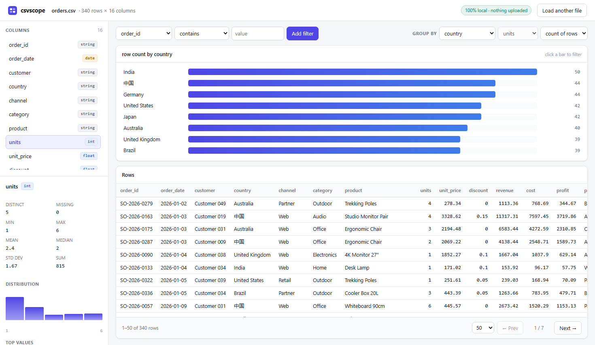

# csvscope

**Point it at a CSV. Get the profile in a second. Nothing leaves your machine.**

[](https://github.com/USERNAME/csvscope/actions/workflows/ci.yml)
[](https://www.python.org/)
[](#quick-start)
[](LICENSE)



`csvscope` is a small local web app for looking at CSV and TSV files. Run one
command, a browser tab opens, you drag a file in, and you immediately see column
types, missing values, distributions and top values — then you can filter, sort
and group the data without writing a single line of SQL.

It is deliberately boring technology: **Python standard library only**. No pandas,
no numpy, no npm, no build step. Clone and run.

## Why

Opening a 300-row CSV in Excel works. Opening it on someone else's laptop,
sending it to a web tool, or explaining what a column contains usually does not.
`csvscope` is the middle ground: a real UI, running locally, with nothing to
install and nothing uploaded.

## Features

- **Type inference** — `int`, `float`, `bool`, `date`, `string`, with support for
  thousands separators (`1,234.50`), currency prefixes (`¥1,299`) and a dozen
  date formats.
- **Column profiles** — missing count, distinct count, min / max / mean / median /
  standard deviation / sum, an adaptive histogram, and the top 8 values.
- **Filters** that compose — `contains`, `=`, `≠`, `>`, `≥`, `<`, `≤`, `is empty`
  and `is not empty`, with operators chosen by column type.
- **Sort + paginate** — click any header, 25–250 rows per page.
- **Group-by charts** — count / sum / avg / median / min / max / distinct by any
  column. Click a bar to turn it into a filter.
- **Delimiter sniffing** — comma, semicolon, tab and pipe, auto-detected.
- **Encoding fallback** — UTF-8 first, then GBK, so Excel-on-Windows exports work.
- **Private by construction** — the server binds to `127.0.0.1` and keeps datasets
  in memory. No telemetry, no uploads, no accounts.

## Quick start

```bash
git clone https://github.com/USERNAME/csvscope.git
cd csvscope
python -m csvscope
```

That opens <http://127.0.0.1:8787/> in your browser. Python 3.9+ and nothing else.

Want to see it with data already loaded? Open <http://127.0.0.1:8787/?sample>.

### Options

```text
python -m csvscope [--host 127.0.0.1] [-p 8787] [--no-browser] [--verbose]

  --host         interface to bind (default: 127.0.0.1)
  -p, --port     preferred port; falls back to a free one if taken
  --no-browser   do not open a browser window
  --verbose      log every HTTP request
```

### Install as a command

```bash
pipx install .        # or: pip install .
csvscope
```

## How it works

Three small pieces:

| Path | Role |
| --- | --- |
| `csvscope/core.py` | Parsing, type inference, profiling, filtering, sorting and aggregation. Pure functions over in-memory tables, no I/O, fully unit tested. |
| `csvscope/server.py` | A `ThreadingHTTPServer` with six JSON routes and static file serving. |
| `csvscope/static/` | One HTML page, one stylesheet, one vanilla-JS app. No framework, no bundler. |

The browser never parses the file — it reads the text and posts it to the local
server, so all number and date handling happens in one place (Python) and the
frontend stays dumb.

### JSON API

Every UI action is one HTTP call, so the API is usable on its own:

```bash
# health check
curl -s localhost:8787/api/health

# load data, keep the returned id
curl -s localhost:8787/api/load -H 'Content-Type: application/json' \
  -d '{"name":"tiny.csv","content":"city,units\nA,3\nB,7\n"}'

# then query it (filters, sort and paging are all optional)
curl -s localhost:8787/api/query -H 'Content-Type: application/json' \
  -d '{"id":"<id>","filters":[{"column":"units","op":"gt","value":"5"}]}'
```

| Endpoint | Purpose |
| --- | --- |
| `GET /api/health` | Liveness and version. |
| `GET /api/example` | The bundled `examples/orders.csv`. |
| `POST /api/load` | `{name, content}` → dataset id, columns, profiles, 50-row preview. |
| `POST /api/query` | `{id, filters, sort, page, page_size}` → rows + total. |
| `POST /api/aggregate` | `{id, group_by, metric, agg, limit, filters}` → series. |
| `POST /api/histogram` | `{id, column, bins, filters}` → bins. |

Filter shape: `{"column": "revenue", "op": "gte", "value": "1000"}`.
Aggregations: `count`, `sum`, `avg`, `min`, `max`, `median`, `distinct`.

## Development

```bash
python -m unittest discover -s tests -v      # 56 tests, ~0.6 s
python -m csvscope --verbose                 # request logging
```

No dependencies to install, no virtualenv required, no linter config to fight.
The test suite covers the engine (type inference, operators, aggregation edge
cases) and boots a real HTTP server to check every route.

## Limits

- Data is held **in memory**; the practical ceiling is a few hundred thousand rows
  (hard limits: 64 MB body, 2,000,000 rows).
- Read-only: `csvscope` explores files, it does not edit them.
- No joins, no SQL, no persistence between sessions.
- Single user, single process. It binds to loopback by design.

## Roadmap

- [ ] Export the filtered view back to CSV
- [ ] Remember filter/sort state in the URL so views can be shared
- [ ] JSONL and Parquet input
- [ ] An optional DuckDB backend for files that do not fit in memory
- [ ] Multi-column group-by

Ideas and pull requests are welcome — see [CONTRIBUTING.md](CONTRIBUTING.md).

## 中文说明

`csvscope` 是一个**本地优先**的 CSV/TSV 数据探查面板：一条命令启动，浏览器打开，
把文件拖进去，立刻看到列类型、缺失值、分布直方图和 TOP 值，然后筛选、排序、分组聚合，
全程不用写 SQL。

```bash
git clone https://github.com/USERNAME/csvscope.git
cd csvscope
python -m csvscope          # 自动打开 http://127.0.0.1:8787/
```

特点：

- **零依赖**：只用 Python 标准库，不用 pandas/numpy，也没有 npm 和构建步骤，`clone` 完直接跑。
- **数据不出本机**：服务只监听 `127.0.0.1`，数据只存在内存里，没有上传、没有埋点。
- **类型推断**：`1,234.50`、`¥1,299` 这类格式都能识别；日期支持十几种常见写法。
- **编码兜底**：先按 UTF-8 解析，失败再试 GBK，Excel 导出的中文 CSV 不会乱码。
- **可点击的图表**：分组图里点一下柱子就变成筛选条件。

想直接看效果：<http://127.0.0.1:8787/?sample>（自动载入示例数据）。

适用：快速看清一份陌生数据、给同事演示字段含义、在不能上传数据的环境里做初步分析。
不适用：百万级以上的大文件、需要写入或联表的场景。

## License

[MIT](LICENSE)
